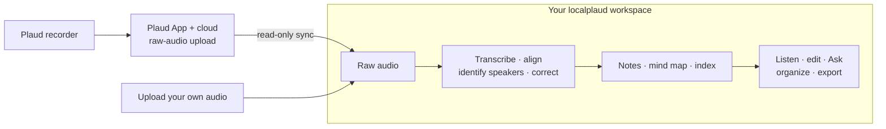

<p align="center">
  
</p>

<h1 align="center">Your recordings. Your intelligence.</h1>

<p align="center">
  Turn Plaud recordings into editable transcripts, useful notes, and answers you can trace.<br>
  An open-source, self-hosted alternative to the Plaud Intelligence workflow.
</p>

<p align="center">
  <a href="https://github.com/skyhong2002/localplaud/actions/workflows/ci.yml"></a>
  <a href="LICENSE"></a>
  <a href="pyproject.toml"></a>
  <a href="#asr-providers"></a>
  <a href="#project-status"></a>
</p>

<p align="center">
  <a href="#what-you-can-do">Explore features</a> ·
  <a href="#quickstart">Get started</a> ·
  <a href="docs/deploy.md">Self-host</a> ·
  <a href="#documentation">Documentation</a> ·
  <a href="https://github.com/skyhong2002/localplaud/discussions">Community</a> ·
  <a href="CONTRIBUTING.md">Contribute</a>
</p>

---

## Keep the recorder. Own what comes next.

Your recorder captures the conversation. **localplaud turns it into knowledge you
can edit, search, and use again**—in a workspace you host.

Keep recording and uploading through the official Plaud App. localplaud downloads
the raw audio and handles transcription, speaker labels, notes, mind maps, search,
Ask, and export independently. **No Plaud Generate button or Plaud-generated
transcript is required.** You can also upload audio directly in the Web App.

Choose local models, explicitly configured cloud providers, or your own remote
worker for each processing stage. The software is MIT-licensed; your hardware,
hosting, and any cloud-provider usage are separate costs.

## What you can do

| From recording to… | What you get |
| --- | --- |
| **A transcript you can trust and correct** | Listen alongside timestamped text, click to seek, rename speakers, edit inline, and compare corrected text with raw ASR. |
| **Notes that fit the conversation** | Generate structured notes with reusable templates, keep multiple outputs, and edit a copy while preserving the original AI artifact. Long recordings use full-transcript coverage. |
| **The bigger picture** | Explore a collapsible mind map and export it as an image. Generate timestamped chapters when you want another way to navigate. |
| **Answers with sources** | Ask about one recording or your library. Transcript citations jump to the audio; note citations open the exact note. Save useful answers as editable notes. |
| **A library you can find things in** | Search titles, transcripts, and notes; organize with folders and tags; filter by date, duration, source, and processing state. Text search works without embeddings. |
| **Less repeat work** | Use AutoFlow rules to choose templates and processing profiles, organize files, export transcripts, and deliver notifications to authorized destinations. |
| **Work you can take with you** | Export audio, transcripts, subtitles, notes, and mind maps—or create a revocable public recording link with the content you choose. |

Use it for meeting decisions and follow-ups, interview review, lecture notes, or
finding the conversation where an idea first came up. The Web App supports desktop
and mobile layouts, with English and Traditional Chinese (Taiwan) interfaces;
translation of some diagnostic and helper text is still expanding.

## Built to keep your work

- **Your edits stay yours.** Raw ASR and user corrections have separate revision
  history. Re-index corrected text without running speech recognition again.
- **A failed stage does not erase a good result.** Transcripts and notes remain
  usable when a later stage fails. Resume the affected work with visible errors.
- **You choose where AI runs.** Stage-specific profiles record the provider, model,
  and configuration. Cloud fallback requires an explicit policy.
- **You can inspect the source.** Generated artifacts retain provenance and
  revision relationships. Imported Plaud AI content is labelled separately and
  excluded from the independent processing path.

## How it works



Plaud handles device transfer and raw-audio upload. localplaud owns the derived
workflow: audio on disk, metadata and artifacts in SQLite, resumable processing,
and a Web App for daily use. See the [product specification](docs/product-workflow.md).

## Project status

**Active development.** The core workflow is implemented, but full Plaud-level
workflow parity, broader integrations, UI polish, and the hardware/language
acceptance matrix are still in progress. Deployment may lag repository changes;
see the [UI rollout notes](docs/mini-integration-20261002.md).

Speech quality depends on the configured models and your recordings. Missing
speaker diarization is a visible degraded state. Voice activity detection and
forced word alignment need explicit setup; neither is enabled by the copied
configuration alone. Taiwan Mandarin and mixed Mandarin/English remain primary
evaluation cases, with broader benchmarks still open.

A recording's Web workspace includes a subscription-independence checklist for
local provenance, speakers, notes, indexing, exports, and other required evidence.
The [acceptance guide](docs/acceptance.md) explains what it verifies.

## Quickstart

You'll need **Python 3.11+**, **ffmpeg**, [uv](https://docs.astral.sh/uv/), and enough
memory and disk for your selected models. The local setup below also uses
[Ollama](https://ollama.com/) for text generation. Install and start Ollama first.
Models download on first use; processing speed depends on your hardware.

### 1. Install

```bash
git clone https://github.com/skyhong2002/localplaud.git
cd localplaud

# CPU: local Whisper, speaker diarization, VAD, and embeddings
uv sync --extra faster-whisper --extra diarize --extra vad --extra local-llm
```

For **Apple Silicon**, use this install command instead:

```bash
uv sync --extra mlx --extra diarize --extra vad --extra local-llm
```

For **NVIDIA/CUDA**, replace `--extra faster-whisper` with `--extra cuda` to include
the CUDA runtime libraries. Docker and remote-worker options are
[documented separately](docs/deploy.md).

### 2. Configure your models

```bash
cp config.example.toml config.toml
cp .env.example .env
ollama pull llama3.1:8b
```

In `config.toml`:

- Choose `asr.provider = "mlx-whisper"` on Apple Silicon; CPU/CUDA uses
  `"faster-whisper"` by default.
- Set `enabled = true` under `[asr.vad]` to enable speech detection.
- Keep `pipeline.artifact_mode = "independent"` for the raw-audio workflow.

For speaker labels, accept the Hugging Face terms for
[`pyannote/speaker-diarization-community-1`](https://huggingface.co/pyannote/speaker-diarization-community-1)
and put your token in `.env`:

```dotenv
LOCALPLAUD_DIARIZE__HF_TOKEN=hf_your_token_here
```

This setup uses Whisper large-v3-turbo, pyannote, Ollama, and local embeddings.
To add forced word alignment, include `--extra forced-align` in your install
command and select the `align:whisperx` provider in an execution profile. The default alignment stage
validates Whisper timestamps; it does not perform forced alignment. See
[speech setup](docs/speech-quality.md) and [acceptance requirements](docs/acceptance.md).

### 3. Connect and launch

```bash
uv run localplaud init
uv run localplaud auth login     # one-time Plaud OAuth in your browser
uv run localplaud auth check
uv run localplaud doctor         # check auth, ffmpeg, and configured providers
uv run localplaud run            # sync + process + serve the Web App
```

Open **[localhost:8080](http://localhost:8080)**. After setup, use the Web App to
review, edit, generate, organize, and export.

### 4. Process your first recording

The first Plaud sync catalogs your existing recordings **without downloading the
whole library**. Open an existing recording and choose **Import audio** to fetch
it. Subsequent newly discovered uploads download automatically.

Control **Automatic processing** in **Settings → Workspace**. When paused,
sync/download continues and AI processing waits for an explicit Resume/Reprocess
action. To use recording or library Q&A, enable **Show Ask** in Workspace
preferences; its navigation is hidden by default.

## Configuration

Start with the commented [config.example.toml](config.example.toml). Settings can
be overridden with environment variables: prefix `LOCALPLAUD_` and separate nested
keys with `__`. Keep credentials in the git-ignored `.env`, for example:

```dotenv
LOCALPLAUD_LLM__OPENAI__API_KEY=your_api_key_here
```

Providers and execution profiles let you select models per stage, define allowed
fallbacks, and set privacy or cost boundaries. Notes support `standard`, `evidence`,
and `legacy` quality modes; `standard` is the current default. See
[note quality](docs/note-quality.md) for coverage, verification, and tradeoffs.

### ASR providers

| Where speech recognition runs | Options |
| --- | --- |
| Apple Silicon, natively | MLX Whisper or whisper.cpp; large-v3-turbo is the baseline. |
| NVIDIA/CUDA or CPU, natively | faster-whisper with large-v3-turbo. CPU processing can be slow. |
| An authenticated remote worker | Run supported speech stages on separate hardware using the [worker protocol](docs/remote-worker.md). |
| An explicitly selected cloud service | OpenAI, Deepgram, or AssemblyAI; privacy and usage charges follow that provider. |

**Whisper transcribes speech; it does not identify speakers.** Local speaker labels
come from the separate diarization stage. See the
[speech architecture](docs/adr/0003-pluggable-asr.md) and
[Qwen + Nemotron profile](docs/qwen-nemotron-production.md) for the evaluated CUDA alternative.

## Deploying to your own machines

Run natively for Apple Silicon Metal acceleration. For Linux, Docker Compose
includes a CUDA `gpu` profile and a slim `cpu` profile for explicitly configured
cloud providers. macOS containers cannot access Metal; the `mac` profile needs a
separately configured speech provider. Caddy provides HTTPS for domain deployments.

Follow the **[deployment guide](docs/deploy.md)** for your hardware and the
[accounts guide](docs/accounts.md) to configure authenticated access.

## FAQ

**Do I need a paid Plaud Intelligence plan?**

The independent pipeline works from raw audio and metadata. It does not require
Plaud-generated transcripts, summaries, or other paid Intelligence artifacts. You
still need access to your recordings through Plaud's upload and read-only API path.

**Is everything local?**

The Plaud recorder path still uploads audio through Plaud's App and cloud. After
download, processing can use local models. Cloud providers and remote workers are
explicit choices; self-hosting alone does not make a cloud profile local.

**Can I use it without a Plaud recorder?**

Yes. Use **Add audio** in the Web App to upload your own files. See
[supported formats and limits](docs/uploads.md).

**Can I bring my existing Plaud notes?**

Yes, through explicit import. They remain labelled Plaud content, with their
provenance preserved. Independent processing derives its own artifacts from audio.

**What can I export?**

Transcripts: TXT, SRT, VTT, DOCX, and PDF, with timestamp and speaker-label controls.
Notes: Markdown, TXT, DOCX, and PDF. Audio, mind-map PNG, Markdown archives, and
library ZIP exports are also available; library ZIPs support up to 50 selected recordings.

## Security

The Web App binds to `127.0.0.1` by default. Before exposing it to a network,
configure [Web App accounts](docs/accounts.md), a session secret, and HTTPS.
Accounts have private workspaces and revocable sessions; AI providers and workers
are shared infrastructure managed by the owner.

Plaud access is read-only. External audio/import downloads are bounded and
SSRF-checked. Keep secrets and OAuth tokens out of source control. Workspace
[backups](docs/backups.md) exclude configuration secrets and Plaud tokens.

## Documentation

| I want to… | Read |
| --- | --- |
| Install and operate my instance | [Deployment](docs/deploy.md) · [Accounts](docs/accounts.md) · [Backups](docs/backups.md) |
| Tune transcription and speakers | [Speech quality](docs/speech-quality.md) · [Remote workers](docs/remote-worker.md) · [Speaker identities](docs/cross-recording-speakers.md) |
| Improve notes and navigation | [Note quality](docs/note-quality.md) · [Chapter outlines](docs/chapter-outline.md) |
| Connect other tools | [Webhooks](docs/webhooks.md) · [Email delivery](docs/email-integrations.md) |
| Understand the product and API | [Product workflow](docs/product-workflow.md) · [Plaud API](docs/plaud-api.md) · [Architecture decisions](docs/adr/) |
| Check readiness or recover a failure | [Acceptance](docs/acceptance.md) · [Processing repair](docs/processing-repair.md) · [Maintenance](docs/maintenance.md) · [Support](docs/support.md) |

## Development

```bash
uv sync --extra dev --extra cloud  # provider tests use mocked SDK calls
uv pip install "torch>=2.8"  # tensor tests; no model weights required
uv run --no-sync ruff check .
uv run --no-sync pytest
```

For a processed recording, `uv run localplaud acceptance-check RECORDING_ID`
audits the subscription-independence gate; add `--json` for automation. The Web App
exposes the same checklist. See [acceptance tests](docs/acceptance.md) and
[UI verification](tests/ui/README.md).

Found a rough edge? [Report a bug](https://github.com/skyhong2002/localplaud/issues/new/choose).
For setup questions and workflow ideas, join
[Discussions](https://github.com/skyhong2002/localplaud/discussions).
Read the [contribution guide](CONTRIBUTING.md) and [Code of Conduct](CODE_OF_CONDUCT.md)
before contributing. Report vulnerabilities through the [private security channel](SECURITY.md).

## License

[MIT](LICENSE) © 2026 Sky Hong

localplaud is an independent, unofficial project and is not affiliated with or
endorsed by Plaud. It accesses only the authenticated user's own account and data.
