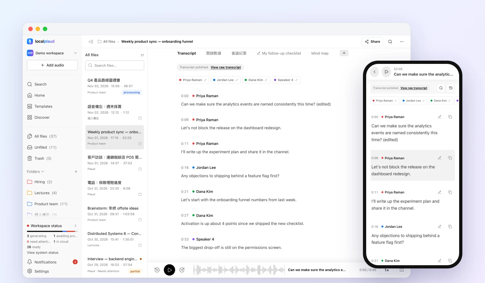
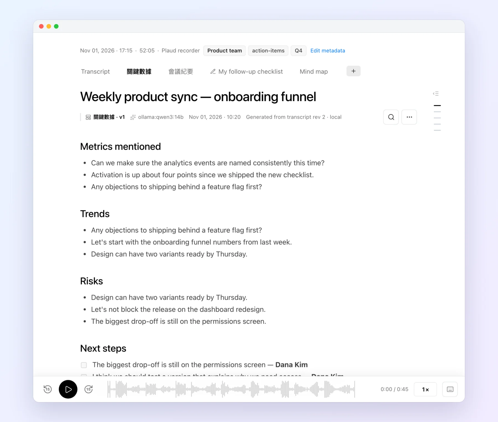
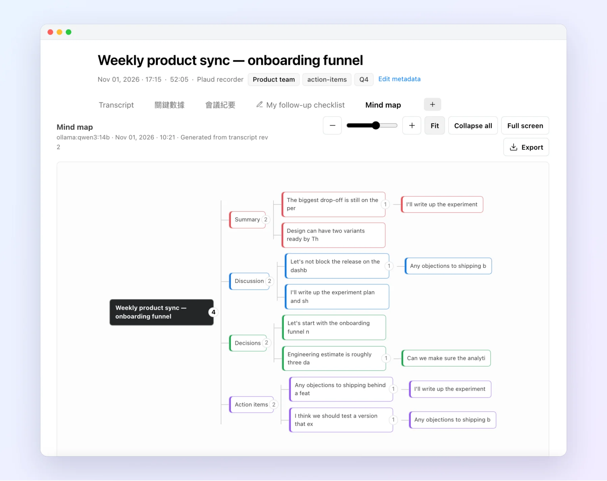
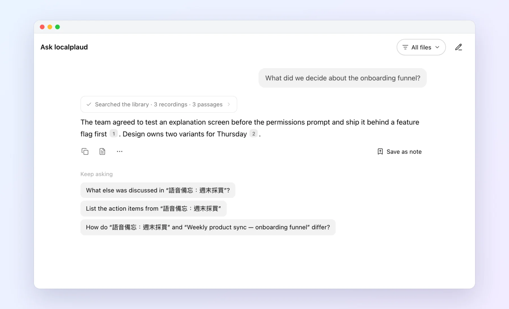
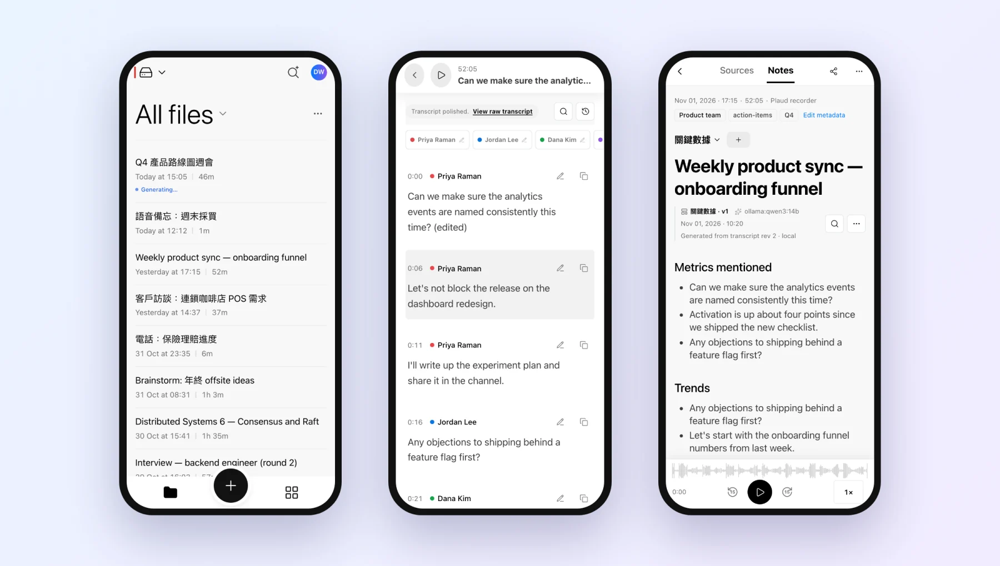
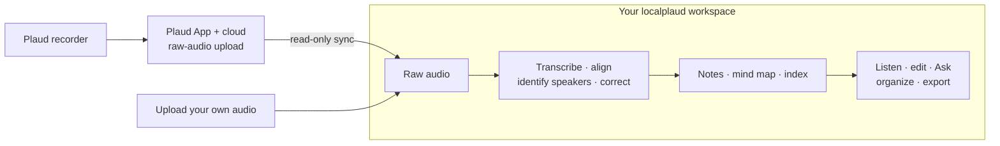

<p align="center">
  
</p>

<h1 align="center">Your recordings. Your intelligence.</h1>

<p align="center">
  Turn Plaud recordings into editable transcripts, useful notes, and answers you can trace.<br>
  An open-source, self-hosted alternative to the Plaud Intelligence workflow.
</p>

<p align="center">
  <a href="https://github.com/skyhong2002/localplaud/actions/workflows/ci.yml"></a>
  <a href="LICENSE"></a>
  <a href="pyproject.toml"></a>
  <a href="docs/deploy.md"></a>
  <a href="#faq"></a>
</p>

<p align="center">
  <a href="https://skyhong2002.github.io/localplaud/demo/"><b>Live demo</b></a> ·
  <a href="#quickstart">Get started</a> ·
  <a href="docs/deploy.md">Self-host</a> ·
  <a href="#documentation">Docs</a> ·
  <a href="https://github.com/skyhong2002/localplaud/discussions">Community</a> ·
  <a href="CONTRIBUTING.md">Contribute</a>
</p>

<p align="center">
  
</p>

Keep recording with your Plaud device and the official Plaud App. localplaud
downloads the raw audio and does the rest on hardware you control—**no Plaud
Generate button, no paid Intelligence plan.** You can also upload any audio file.

## Features

### Transcripts with speakers you can name

Shown above: Whisper large-v3-turbo plus pyannote diarization. Click any line to seek, rename
speakers once, fix text inline, and compare the corrected transcript with raw ASR.

### Notes from your own templates

Full-transcript coverage for long recordings, several note styles per recording,
and every note shows which model and transcript revision produced it.

<p align="center"></p>

### A mind map of every conversation

<p align="center"></p>

### Ask your whole library

Answers cite the recordings they came from; each citation jumps to the moment in the audio.

<p align="center"></p>

### Made for your phone, too

<p align="center"></p>

Plus folders, tags, full-text search, AutoFlow automation, and exports to TXT,
SRT, VTT, DOCX, PDF, and Markdown. Your edits are never overwritten, a failed
stage never discards good results, and you choose per stage whether AI runs
locally, on your own worker, or with a cloud provider.

<sub>Screenshots use the synthetic demo library from <code>scripts/seed_demo.py</code>.</sub>

## How it compares

Speaker labels are one of the most frequent complaints in r/PlaudNoteUsers:
voices merged or split, and names that must be re-entered for every recording.
Plaud's own help center says it [does not automatically identify other
speakers](https://support.plaud.ai/hc/en-us/articles/54027338385177-Auto-speaker-labeling).

| | **localplaud** | Plaud Intelligence | Otter.ai | Meetily (open source) |
| --- | --- | --- | --- | --- |
| Price | Free (MIT) + your hardware | Free 300 min/mo · Pro $17.99/mo · Unlimited $29.99/mo | Free 300 min/mo · Pro $16.99/mo | Free · Pro $10/user/mo |
| Minute caps | None | 300 / 1,200 / unlimited | 300 / 1,200 / unlimited | None |
| Where AI runs | Local, your worker, or a cloud provider you choose | Plaud cloud | Otter cloud | Local or your API key |
| Self-hostable | ✅ | — | — | ✅ |
| Speaker diarization | ✅ pyannote, editable per segment | ✅ | ✅ | Pro plan |
| Names remembered across recordings | ✅ optional local voiceprints | Your own voice only | ✅ (cloud) | Not verified |
| Speaker rename updates notes | Re-indexed instantly; notes regenerate with no per-minute fees | Regenerate summary (uses minutes) | Not verified | Not verified |
| Works with Plaud recorders | ✅ automatic raw-audio sync | ✅ | Manual file upload | Not verified |
| Bulk export | ZIP of up to 50 recordings | Per file | Business plan | Not verified |

Sources (November 2026, monthly USD pricing):
[Plaud plans](https://www.plaud.ai/pages/plaud-ai-plan-pricing) ·
[Otter speaker ID](https://help.otter.ai/hc/en-us/articles/21665587209367-Speaker-Identification-Overview) ·
[Otter export](https://help.otter.ai/hc/en-us/articles/360047733634-Export-conversations) ·
[Meetily](https://meetily.ai/pro). “Not verified” means we found no public source.
localplaud's cross-recording voice identification is an optional
[voice service](docs/cross-recording-speakers.md) that needs extra setup.
Spot an error? [Open an issue](https://github.com/skyhong2002/localplaud/issues/new/choose).

## How it works



Speech runs on Whisper large-v3-turbo (MLX on Apple Silicon, faster-whisper on
CUDA/CPU) with pyannote speaker diarization. Text generation defaults to Ollama.

## Quickstart

Requires **Python 3.11+**, **ffmpeg**, [uv](https://docs.astral.sh/uv/), and a
running [Ollama](https://ollama.com/).

```bash
git clone https://github.com/skyhong2002/localplaud.git
cd localplaud

# Apple Silicon: use --extra mlx · NVIDIA: use --extra cuda
uv sync --extra faster-whisper --extra diarize --extra vad --extra local-llm

cp config.example.toml config.toml
cp .env.example .env
ollama pull llama3.1:8b
```

For speaker labels, accept the terms for
[`pyannote/speaker-diarization-community-1`](https://huggingface.co/pyannote/speaker-diarization-community-1)
and add `LOCALPLAUD_DIARIZE__HF_TOKEN=hf_...` to `.env`. On Apple Silicon, set
`asr.provider = "mlx-whisper"` in `config.toml`.

```bash
uv run localplaud init
uv run localplaud auth login   # one-time Plaud OAuth
uv run localplaud doctor       # check auth, ffmpeg, and providers
uv run localplaud run          # sync + process + serve
```

Open **[localhost:8080](http://localhost:8080)**. The first sync catalogs your
library without downloading it; choose **Import audio** on any recording, and new
uploads download automatically. Docker, CUDA, and remote-worker setups are in the
[deployment guide](docs/deploy.md).

## FAQ

**Is everything local?** Plaud's App still uploads audio to Plaud's cloud. After
download, processing can be fully local; cloud providers are opt-in per stage.

**Can I use it without a Plaud recorder?** Yes—upload files with **Add audio**
([formats](docs/uploads.md)).

**Is it safe to expose online?** It binds to `127.0.0.1` by default. Configure
[accounts](docs/accounts.md), a session secret, and HTTPS first. Plaud access is
read-only.

**Is it finished?** It's in active development. The core workflow works end to
end; full Plaud parity and broader language/hardware benchmarks are in progress.

## Documentation

| Topic | Read |
| --- | --- |
| Install and operate | [Deployment](docs/deploy.md) · [Accounts](docs/accounts.md) · [Backups](docs/backups.md) |
| Speech and speakers | [Speech quality](docs/speech-quality.md) · [Remote workers](docs/remote-worker.md) · [Speaker identities](docs/cross-recording-speakers.md) |
| Notes | [Note quality](docs/note-quality.md) · [Chapter outlines](docs/chapter-outline.md) |
| Integrations | [Webhooks](docs/webhooks.md) · [Email delivery](docs/email-integrations.md) |
| Product and API | [Changelog](CHANGELOG.md) · [Product workflow](docs/product-workflow.md) · [Plaud API](docs/plaud-api.md) · [ADRs](docs/adr/) |
| Troubleshooting | [Acceptance](docs/acceptance.md) · [Processing repair](docs/processing-repair.md) · [Support](docs/support.md) |

## Contributing

See the [contribution guide](CONTRIBUTING.md) and [Code of Conduct](CODE_OF_CONDUCT.md).
Questions go to [Discussions](https://github.com/skyhong2002/localplaud/discussions);
vulnerabilities to the [private security channel](SECURITY.md).

## License

[MIT](LICENSE) © 2026 Sky Hong. localplaud is an independent project, not
affiliated with or endorsed by Plaud.
